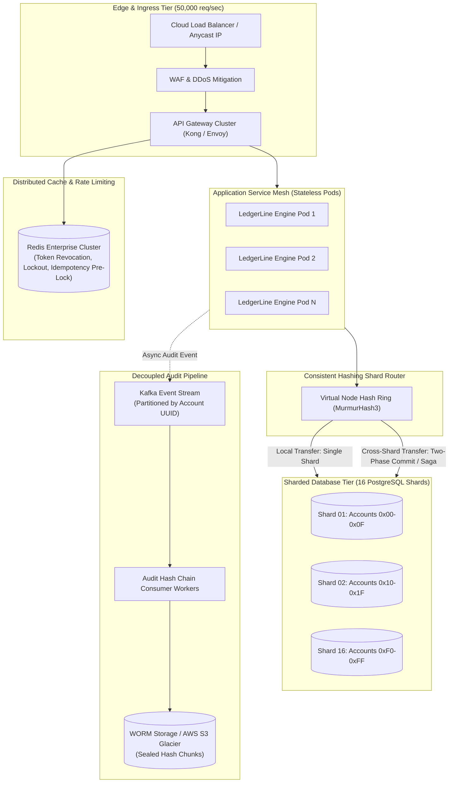

# LedgerLine — Architectural Defense & System Scaling Blueprint (INTERVIEW_PREP.md)

This document provides a comprehensive technical defense of LedgerLine's core architecture, an analysis of key trade-offs, and an engineering blueprint for scaling the system to **10,000 Transactions Per Second (TPS)**.

---

## 1. Architectural Defense: Why the System Was Built This Way

### 1.1 Strict Integer Minor-Units Arithmetic vs. `BigDecimal` / Floating Point
- **Design Decision**: All monetary values are strictly `BIGINT` minor units (paise; ₹1.00 = `100`). Arithmetic is executed via `Math.addExact` and `Math.subtractExact`. Floating-point numbers (`float`, `double`, `BigDecimal` with rounding modes) are strictly rejected at the API DTO boundary.
- **Why Alternatives Were Rejected**:
  - `float` and `double` use IEEE 754 binary floating-point representation, which cannot precisely represent decimal fractions like $0.10$. Over millions of transactions, fractional rounding errors accumulate into unaccounted balance drift.
  - `BigDecimal` supports arbitrary precision, but introduces runtime overhead and relies on configurable `RoundingMode`. If a developer forgets or misconfigures rounding in a division or interest calculation, it can either leak fractions or throw unhandled `ArithmeticException`s in production.
  - `BIGINT` paise provides exact, deterministic discrete arithmetic up to $9.22 \times 10^{18}$ paise ($\approx ₹92$ quadrillion), while `Math.addExact` provides hardware-speed overflow protection.

### 1.2 Deterministic Ascending UUID Locking vs. Optimistic Locking
- **Design Decision**: Every multi-account transaction acquires pessimistic row locks (`SELECT ... FOR UPDATE`) in deterministic ascending UUID order:
  $$\text{firstLock} = \min(A, B), \quad \text{secondLock} = \max(A, B)$$
- **Why Alternatives Were Rejected**:
  - *Unordered Pessimistic Locking*: If Thread 1 transfers $A \to B$ (locks $A$, then requests $B$) while Thread 2 transfers $B \to A$ (locks $B$, then requests $A$), a cyclic dependency is established. PostgreSQL detects this deadlock and kills one of the transactions with SQLSTATE `40P01`, causing user-facing 500 errors and degraded throughput.
  - *Optimistic Locking (`@Version`)*: Under high concurrency on a popular merchant or central account (e.g. 100 concurrent payments to the same account), optimistic locking causes 99 out of 100 transactions to fail with `OptimisticLockException`, forcing expensive client or queue retries. Deterministic pessimistic locking serializes access cleanly with zero deadlocks.

### 1.3 In-Database Idempotency Locking vs. Distributed Redis Locks
- **Design Decision**: Idempotency is enforced within the primary PostgreSQL database transaction using `INSERT INTO idempotency_keys ... ON CONFLICT DO NOTHING` followed by `SELECT ... FOR UPDATE`.
- **Why Alternatives Were Rejected**:
  - Distributed locks (such as Redis Redlock) operate outside the database's ACID boundary. If Redis grants the lock, but the database connection fails or the application crashes midway, the lock state and database state become out-of-sync.
  - Enforcing idempotency inside the relational transaction guarantees atomic synchronization: the idempotency record, ledger entries, balance updates, and audit trail commit or roll back as an unbreakable unit.

### 1.4 Database-Level Append-Only Triggers vs. Application-Only Authorization
- **Design Decision**: Database triggers unconditionally raise SQLSTATE `55000` on any `UPDATE`, `DELETE`, or `TRUNCATE` executed against `transfers`, `ledger_entries`, or `audit_log`.
- **Why Alternatives Were Rejected**:
  - Relying exclusively on application-level `@PreAuthorize` assumes the application is the only actor with database access. In reality, security breaches, SQL injection vulnerabilities, malicious database administrators, or flawed migration scripts can bypass application logic.
  - Enforcing append-only semantics inside the PostgreSQL engine provides defense-in-depth: even a compromised Spring Boot application cannot alter historical ledger entries.

### 1.5 Linear Cryptographic Hash Chain vs. Merkle Trees
- **Design Decision**: The audit log chains entries sequentially using SHA-256 with a PostgreSQL transaction-scoped advisory lock:
  $$\text{hash}_n = \text{SHA-256}(\text{hash}_{n-1} \parallel \text{seq} \parallel \text{actor\_id} \parallel \text{action} \parallel \dots)$$
- **Why Alternatives Were Rejected**:
  - While Merkle trees allow efficient $O(\log N)$ proof-of-inclusion for individual transactions, they are optimized for distributed p2p blockchains where participants need to verify specific branches without downloading the entire chain.
  - For a high-integrity centralized financial ledger, auditors require a strict, tamper-evident temporal timeline. Sequential hash chaining guarantees that no transaction can be inserted, omitted, or reordered between existing records without invalidating all downstream hashes.

### 1.6 `Propagation.REQUIRES_NEW` for Security Failure Logging
- **Design Decision**: Security-critical failures (403 Forbidden, 404 on foreign accounts, invalid amounts) are written to `audit_log` inside an isolated `REQUIRES_NEW` transaction.
- **Why Alternatives Were Rejected**:
  - In a standard Spring transaction (`Propagation.REQUIRED`), an unhandled exception or business failure triggers a complete transaction rollback.
  - Rolling back the entire transaction would erase the audit trail record of the unauthorized or malicious attempt, blinding security incident responders. `REQUIRES_NEW` ensures the audit entry is permanently committed to disk regardless of the primary operation's rollback.

### 1.7 HTTP 404 Not Found vs. 403 Forbidden on Foreign Accounts (Anti-IDOR)
- **Design Decision**: When User A attempts to access User B's account, `AccountAccessPolicy` returns HTTP 404 Not Found rather than HTTP 403 Forbidden.
- **Why Alternatives Were Rejected**:
  - Returning HTTP 403 Forbidden confirms to an attacker that the targeted UUID exists on the platform, allowing automated enumeration of valid account IDs.
  - Returning HTTP 404 Not Found makes foreign accounts indistinguishable from non-existent accounts, denying attackers information leakage.

---

## 2. Architectural Trade-Offs

| Decision | Primary Advantage | Trade-Off / Operational Cost |
|---|---|---|
| **Pessimistic Row Locking** | Zero deadlocks; absolute consistency; no lost updates. | Higher lock wait times on hot accounts under concurrent bursts. |
| **In-Memory JWT Storage** | Immune to persistent XSS theft via malicious browser scripts. | Token is wiped on full page reload, requiring re-authentication or silent refresh. |
| **Advisory Lock on Audit Append** | Prevents sequence forks and maintains linear chain integrity. | Serializes audit append operations across concurrent write transactions. |
| **Bilateral Double-Entry Pairs** | Strict zero-sum conservation ($\sum \text{entries} = 0$). | Doubles the storage required for ledger entries (2 rows per transfer). |

---

## 3. Blueprint: Scaling LedgerLine to 10,000 TPS

Currently, a single PostgreSQL instance executing ACID transactions with row-level locks and advisory locks handles approximately 500 to 1,500 TPS depending on hardware and disk I/O. Scaling to **10,000 TPS** requires removing shared-resource contention while preserving financial conservation and idempotency.



### 3.1 Step 1: Distributed Sharding by Account UUID
- **Mechanism**: Partition the `accounts`, `transfers`, and `ledger_entries` tables across 16 PostgreSQL shards using consistent hashing on `account_id` (e.g. MurmurHash3 with 256 virtual nodes).
- **Intra-Shard Transfers**: When both `fromAccountId` and `toAccountId` reside on the same database shard (which occurs $\approx 1/16$ or $6.25\%$ of the time), the transfer executes locally with the current deterministic ascending UUID locking logic at full ACID speed.
- **Cross-Shard Transfers (Two-Phase Commit / Orchestrated Saga)**:
  - For transfers spanning two shards, use an Orchestrated Saga backed by a high-performance state machine:
    1. **Prepare Phase**: Shard A places a conditional hold/reservation on the sender's balance.
    2. **Commit Phase**: Shard B credits the recipient account.
    3. **Finalize Phase**: Shard A converts the hold into a completed debit.
  - If Shard B fails (e.g., account frozen), a compensating transaction on Shard A releases the reservation.

### 3.2 Step 2: High-Throughput Audit Streaming (Decoupled Hash Batching)
- **Current Bottleneck**: `pg_advisory_xact_lock(74291847129)` serializes all audit writes into a single global queue, capping audit throughput at ~1,500 appends/second.
- **10,000 TPS Solution (Epoch-Based Merkle Trees)**:
  1. Transfer transactions publish signed audit events directly to an Apache Kafka topic partitioned by account shard.
  2. Audit worker nodes process incoming events in micro-batches (e.g., every 100 milliseconds or 1,000 events).
  3. For each micro-batch, compute a Merkle Tree. Chained root hashes are committed to a dedicated immutable audit ledger:
     $$\text{RootHash}_T = \text{SHA-256}(\text{RootHash}_{T-1} \parallel \text{MerkleRoot}(\text{Events}_T))$$
  4. This decouples transaction commit latency from audit hashing while preserving cryptographic tamper-evidence.

### 3.3 Step 3: Read-Replica Offloading for Statements and Audits
- Separate write paths from analytical query paths using PostgreSQL streaming replication:
  - **Write Cluster**: Primary nodes handle exclusive updates, inserts, and transfers.
  - **Read Cluster**: 3 to 5 read-only replica nodes per shard serve:
    - Statement generation (`GET /api/accounts/{id}/statement`)
    - Historical ledger tape queries
    - Conservation verification (`GET /api/ledger/conservation`)
  - Configured with `replica-lag` monitoring to ensure statement consistency.

### 3.4 Step 4: Redis Distributed Pre-Locking for Idempotency
- **Mechanism**: When a request arrives with an `Idempotency-Key`, the API Gateway issues a Redis atomic command:
  ```redis
  SET idempotency:{userId}:{key} "IN_PROGRESS" NX EX 120
  ```
- **Benefit**: If an automated script fires 100 concurrent requests with the identical key, Redis drops 99 requests at the gateway tier, protecting database connection pools and row locks from synthetic storm contention.

### 3.5 Step 5: Hardware & Connection Pool Sizing for 10,000 TPS
- **Connection Pooling**: Deploy **PgBouncer** in transaction pooling mode in front of each PostgreSQL shard, maintaining 50–100 persistent server connections while multiplexing 5,000 client application connections.
- **Database Node Sizing**:
  - 16 PostgreSQL shards on cloud instances with 32 vCPUs, 128 GB RAM, and Provisioned IOPS NVMe SSDs (15,000+ IOPS per shard).
  - Write-Ahead Logging (WAL) configured with `wal_compression = on`, `synchronous_commit = off` (with battery-backed/NVMe write cache), or grouped commits (`commit_delay = 1000`).
- **Application Sizing**: 20 Kubernetes stateless pods running Spring Boot with Virtual Threads (Project Loom enabled in Java 21) consuming $\le 2$ GB RAM each.

