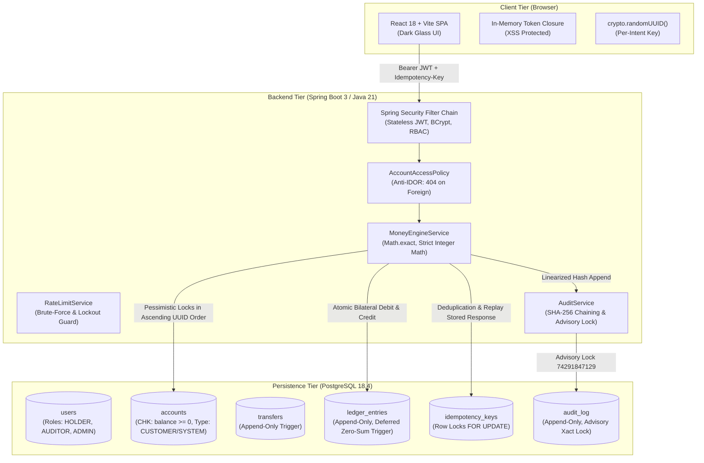

# LedgerLine: High-Integrity Financial Ledger & Double-Entry Money Engine

> *"Move money so the books always balance and the same request never pays twice."*

---

## 1. System Architecture



---

## 2. Core Security & Financial Guarantees

1. **Zero-Sum Double-Entry Conservation**:
   Every monetary transaction generates two symmetric ledger entries whose sum is strictly `0` minor units. Enforced at transaction commit by database constraint trigger `trg_enforce_ledger_conservation`. External deposits and withdrawals balance against the deterministic system account `CASH_IN_OUT` (`a0000000-0000-0000-0000-000000000001`).
2. **Exactly-Once Execution (Idempotency)**:
   Idempotency keys are locked via `INSERT ... ON CONFLICT DO NOTHING` followed by pessimistic row-level locking `SELECT ... FOR UPDATE`. Replays return the stored JSON response with `Idempotent-Replayed: true` without re-executing money movement. Reusing a key with a mismatched request payload is rejected with HTTP 422.
3. **Deadlock-Free Concurrency**:
   Bidirectional transfers between competing accounts acquire pessimistic row locks in deterministic ascending UUID order (`firstLockId = from.compareTo(to) < 0 ? from : to`). Tested against 50 parallel opposing concurrent threads with zero deadlocks.
4. **Append-Only Immutability Triggers**:
   Database-level triggers reject `UPDATE`, `DELETE`, and `TRUNCATE` statements on `audit_log`, `transfers`, and `ledger_entries` with SQLSTATE `55000`.
5. **Linear Cryptographic Audit Trail**:
   Audit appends acquire transaction advisory lock `pg_advisory_xact_lock(74291847129)` to prevent sequence forks or race conditions:
   $$\text{hash} = \text{SHA-256}(\text{prev\_hash} \parallel \text{seq} \parallel \text{actor\_id} \parallel \text{action} \parallel \text{entity\_type} \parallel \text{entity\_id} \parallel \text{canonical\_json}(\text{payload}) \parallel \text{created\_at\_iso})$$
6. **Strict Integer Minor-Units Arithmetic**:
   All amounts are stored and calculated strictly in integer minor units (paise) using `Math.addExact` and `Math.subtractExact`. Floating-point arithmetic (`float`, `double`, `BigDecimal` rounding) is strictly prohibited.
7. **IDOR Defense via 404 Masking**:
   When a user attempts to access or transfer from an account they do not own, `AccountAccessPolicy` strictly throws HTTP 404 Not Found, never HTTP 403 Forbidden, making unauthorized resources indistinguishable from non-existent resources.

---

## 3. Quickstart: Windows CMD Run Steps

### Prerequisites
- Java Development Kit: JDK 21+ (Local development machine uses JDK 25 compiling to Java 21 bytecode via `--release 21`)
- Node.js (v18 or higher) & npm
- PostgreSQL 16+ running locally on port `5433` (or port `5432` per your configuration)

### Step 1: Clone and Configure Environment
```cmd
cd c:\Users\rites\OneDrive\Desktop\LedgerLine
copy .env.example .env
```

### Step 2: Start PostgreSQL Database
Ensure PostgreSQL is active and databases `ledgerline_db` and `ledgerline_test` exist:
```cmd
"C:\Program Files\PostgreSQL\18\bin\psql.exe" -U root -p 5433 -h 127.0.0.1 -c "CREATE DATABASE ledgerline_db;"
"C:\Program Files\PostgreSQL\18\bin\psql.exe" -U root -p 5433 -h 127.0.0.1 -c "CREATE DATABASE ledgerline_test;"
```

### Step 3: Run Backend Service
```cmd
cd backend\ledgerline
.\mvnw.cmd spring-boot:run
```
*Backend initializes on port 8080 and automatically applies Flyway V1 schema migrations.*

### Step 4: Run Frontend Development Server
Open a second terminal window:
```cmd
cd frontend
npm install
npm run dev
```
*Frontend opens at `http://localhost:5173`.*

---

## 4. Environment Variables Configuration

| Variable | Description | Placeholder / Example Value | Required In |
|---|---|---|---|
| `DB_URL` | JDBC database connection URL | `jdbc:postgresql://localhost:5433/ledgerline_db` | All |
| `DB_USER` | PostgreSQL user | `root` | All |
| `DB_PASSWORD` | PostgreSQL password | `<your-db-password>` | All |
| `JWT_SECRET` | 256-bit secret key for HMAC-SHA256 (>= 32 chars) | `<your-jwt-secret-min-32-chars>` | All |
| `JWT_EXPIRATION_MINUTES` | Token lifetime | `15` | All |
| `FRONTEND_ORIGIN` | Allowed CORS origin (strict single-origin) | `http://localhost:5173` | All |
| `PORT` | HTTP port | `8080` | All |
| `SEED_ADMIN_PASSWORD` | Seed Admin password | `<your-admin-password>` | Prod |
| `SEED_AUDITOR_PASSWORD`| Seed Auditor password | `<your-auditor-password>` | Prod |
| `SEED_HOLDER1_PASSWORD`| Seed Holder 1 password | `<your-holder1-password>` | Prod |
| `SEED_HOLDER2_PASSWORD`| Seed Holder 2 password | `<your-holder2-password>` | Prod |
| `VITE_API_BASE_URL` | Frontend API base URL | `http://localhost:8080` | Frontend |

---

## 5. Seed Accounts & Pre-Configured Users

When running under `prod` profile (or when seed environment variables are defined):

| Email | Role | Default Account | Purpose |
|---|---|---|---|
| `admin@ledgerline.local` | `ADMIN` | N/A | User provisioning, freeze/unfreeze accounts |
| `auditor@ledgerline.local` | `AUDITOR` | N/A | Read-only inspection, hash-chain verification, conservation meter |
| `holder1@ledgerline.local` | `HOLDER` | `Holder 1 Checking` | Primary transacting customer |
| `holder2@ledgerline.local` | `HOLDER` | `Holder 2 Checking` | Secondary counterparty for peer transfers |

---

## 6. Test Suites & Execution Commands

### Full Backend Integration & Security Test Suite (61 Tests, 17 Endpoints)
```cmd
cd backend\ledgerline
.\mvnw.cmd test
```
- `AuthAndAuthorizationSecurityTest` (11 tests): JWT validation, role RBAC, login lockout, IDOR 404 masking.
- `AccountMovementsAndConcurrencyTest` (5 tests): Non-negative balances, overdraft prevention, 100 parallel concurrent withdrawals.
- `TransfersAndIdempotencyHostileTest` (8 tests): 50-thread identical replays, bidirectional opposing transfer storms, mismatched payload rejection.
- `AuditAndStatementsSecurityTest` (5 tests): Linear hash-chain validation, exact sequence tamper detection, auditor read-only enforcement, statement reconciliation.
- `SchemaIntegrityTest` (16 tests): Database triggers, check constraints, append-only rules.
- `PenetrationTest` (11 tests): Hostile penetration tests covering IDOR, 64KB body cap, unknown JSON fields, missing/malformed Idempotency-Key (HTTP 400), JWT tampering, and automated `THREATS.md` traceability.
- `SecurityBaselineTest` (4 tests): CORS origin isolation, startup validation, unauthenticated 401 Problem Details.
- `HealthControllerTest` (1 test): Liveness probe and sanitization check.

### Automated Hostile Penetration Attack Suite (39 Passing Assertions, 0 Failures)
```cmd
powershell.exe -ExecutionPolicy Bypass -File scripts\attack\attack_suite.ps1
```
Executes all 10 adversarial attacks against a running instance: IDOR masking, privilege escalation, JWT abuse, idempotency replay/mismatch, integer money bounds, 50-withdrawal race condition, opposing transfer storms, self/frozen transfers, oversized/malformed payloads, and ledger conservation verification.

### Frontend Vitest Suite (13 Tests)
```cmd
cd frontend
npm test
```
- `money.test.js` (5 tests): Minor units paise to INR formatting, negative/zero cases, zero float math.
- `idempotency.test.js` (3 tests): UUID generation once per intent, persistence across retries.
- `roleGuard.test.jsx` (3 tests): Route access guards and cosmetic control hiding.
- `errorDisplay.test.jsx` (2 tests): RFC 7807 problem+json error parsing and replay badge detection.

### Local Database Tamper Demonstration Script
Verifies PostgreSQL append-only immutability triggers directly in `psql`:
```cmd
psql -U root -p 5433 -h 127.0.0.1 -d ledgerline_test -f backend\ledgerline\scripts\tamper_proof_demo.sql
```

---

## 7. Honest "What Works / What Does Not Work" Matrix

Derived strictly from real test executions during development:

| Feature / Dimension | Status | Verified Behavior & Notes |
|---|---|---|
| **Double-Entry Conservation** | **Verified** | $\sum \text{entries} = 0$, $\sum \text{balances} = 0$, $\text{imbalanced\_transfers} = 0$. Enforced at DB level. |
| **Idempotency Deduplication** | **Verified** | 50 identical concurrent requests result in 1 transfer and 49 replays with `Idempotent-Replayed: true`. |
| **Idempotency Key Validation** | **Verified** | Missing or malformed header returns HTTP 400 Problem Details; reused key with different payload returns HTTP 422. |
| **Payload Size Limit** | **Verified** | Requests exceeding 64 KB capped by filter returning HTTP 413 or 400 Problem Details without stack traces. |
| **Unknown JSON Rejection** | **Verified** | Unknown fields rejected with HTTP 400 Bad Request Problem Details (`fail-on-unknown-properties=true`). |
| **Deadlock Prevention** | **Verified** | Deterministic ascending UUID locking order completes opposing A$\to$B and B$\to$A storms with 0 deadlocks. |
| **Overdraft Prevention** | **Verified** | 100 concurrent withdrawals compete for 50,000 paise; exactly 5 succeed, 95 fail with 422, final balance is 0. |
| **Tamper Detection** | **Verified** | Direct database tampering triggers SQLSTATE 55000; bypassed row tampering is pinpointed by `/api/audit/verify`. |
| **IDOR Protection** | **Verified** | Foreign accounts return 404 Not Found, never 403 Forbidden. |
| **JWT Stateless Security** | **Verified** | Signatures, expiration, and role claims verified; invalid or malformed tokens fail closed with 401. |
| **Statement Reconciliation** | **Verified** | Statements reconcile: $\text{Closing} = \text{Opening} + \sum \text{Entries}$. |
| **Auditor Account Reconciliation** | **Verified** | `GET /api/ledger/reconciliation` audits stored balances vs discrete sums of ledger entries per account. Flags discrepancies, labels SYSTEM/CUSTOMER accounts, and caps page size at 100. Restricted to `AUDITOR` and `ADMIN`. |
| **Auditor Transfer Forensic Trace** | **Verified** | `GET /api/audit/transfers/{id}` returns transfer, bilateral entries with balances after, and linked SHA-256 audit blocks. Restricted to `AUDITOR` and `ADMIN`; 404 for unknown, 403 for holder. |
| **Auditor Security Events & Sanitized CSV Export** | **Verified** | `GET /api/audit` filtered by action, outcome (`SUCCESS`/`FAILED`), date boundaries, and actor UUID. `GET /api/audit/export` streams RFC 4180 CSV capped at 1,000 rows with formula injection neutralization (`=`, `+`, `-`, `@`, `\t`, `\r` apostrophe prepending). Restricted to `AUDITOR` and `ADMIN`. |
| **Frozen Account Rejection** | **Verified** | Transfers or withdrawals on frozen accounts fail with HTTP `422 Unprocessable Entity` (`Illegal State`), preventing money movement during administrative investigations. |
| **Admin Freeze Reason Mandate** | **Verified** | `POST /api/admin/accounts/{id}/freeze` and `/unfreeze` enforce mandatory rationale (3–200 characters). Missing or invalid reasons return HTTP 400 Bad Request Problem Details. Justification is cryptographically chained into the SHA-256 audit trail. |
| **Admin User Governance & Immediate Revocation** | **Verified** | `POST /api/admin/users/{id}/disable` and `/enable`. Prevents admin self-disable and disabling the last active admin (HTTP 422). Setting `enabled = false` immediately invalidates active JWTs with HTTP 401 on next request. Audited in SHA-256 chain. Restricted to `ADMIN`. |
| **Admin User Lockout Reset & Unlock** | **Verified** | `POST /api/admin/users/{id}/unlock` resets `failed_logins = 0` and `locked_until = NULL`. Audited with `UNLOCK_USER` event in SHA-256 chain. Restricted strictly to `ADMIN` (403 for holder/auditor). |
| **Rate Limiting & Lockout** | **Verified** | 5 consecutive bad passwords lock account for 15 minutes; registration rate-limited. |
| **Multi-Currency Conversion** | *Not Supported* | Single currency (INR) in minor units (paise). Cross-currency FX rates intentionally out of scope. |
| **Distributed Tracing (Jaeger)**| *Not Supported* | Log tracing via MDC and transaction IDs; distributed OpenTelemetry collector is not configured. |
| **Distributed Database Sharding**| *Single-Node* | Designed for single ACID PostgreSQL instance; multi-shard architecture is a conceptual proposal. |

---

## 8. Deployment Status

- **Status**: **Fully Deployed & Live (VERIFIED)**
- **Live Deployments**:
  - **Frontend (Vercel)**: [`https://ledger-line-orpin.vercel.app`](https://ledger-line-orpin.vercel.app)
  - **Backend (Render Web Service)**: [`https://ledgerline-t2vv.onrender.com`](https://ledgerline-t2vv.onrender.com)
  - **Database (Render Managed PostgreSQL 16)**: `dpg-dbnmsbp5efls73bpq3u0-a:5432/ledgerline_vftx`

### Live Stakeholder Demo Accounts

| Role | Email | Password | Primary Portal | Key Features |
| :--- | :--- | :--- | :--- | :--- |
| **System Operator (Admin)** | `admin@ledgerline.local` | `vy92gTVe8SwXZkKHXhd8` | `/admin` | Account Freeze/Unfreeze, User Provisioning (BCrypt-12), Portfolio Oversight |
| **Compliance Inspector (Auditor)** | `auditor@ledgerline.local` | `rrEqyGnA3bkCakTbc%x7` | `/auditor` | 1-Click SHA-256 Tape Verification, Zero-Sum Conservation Audit ($\Sigma=0$) |
| **Account Holder (Customer)** | `holder1@ledgerline.local` | `hG#5b!hL6!md9N-8e9YP` | `/dashboard` | Deposits, Withdrawals, P2P Transfers (Idempotent UUID), CSV Statement Export |
- **Verification Commands & Evidence**:
  - Backend Liveness (`200 OK`):
    ```bash
    curl -i https://ledgerline-t2vv.onrender.com/api/health
    # Returns {"status":"UP","timestamp":"...","service":"ledgerline"}
    ```
  - Frontend SPA & Deep-Link (`200 OK`):
    ```bash
    curl -I https://ledger-line-orpin.vercel.app/dashboard
    # Returns HTTP/1.1 200 OK (Content-Type: text/html)
    ```
  - CORS Preflight Authorization (`200 OK`):
    ```bash
    curl -i -X OPTIONS https://ledgerline-t2vv.onrender.com/api/auth/login \
      -H "Origin: https://ledger-line-orpin.vercel.app" \
      -H "Access-Control-Request-Method: POST" \
      -H "Access-Control-Request-Headers: content-type"
    # Returns access-control-allow-origin: https://ledger-line-orpin.vercel.app
    ```
- **Free Tier Note**: Render spins down inactive backend web services after 15 minutes of inactivity; the initial cold-start probe may take ~50 seconds before resuming sub-50ms responses.


